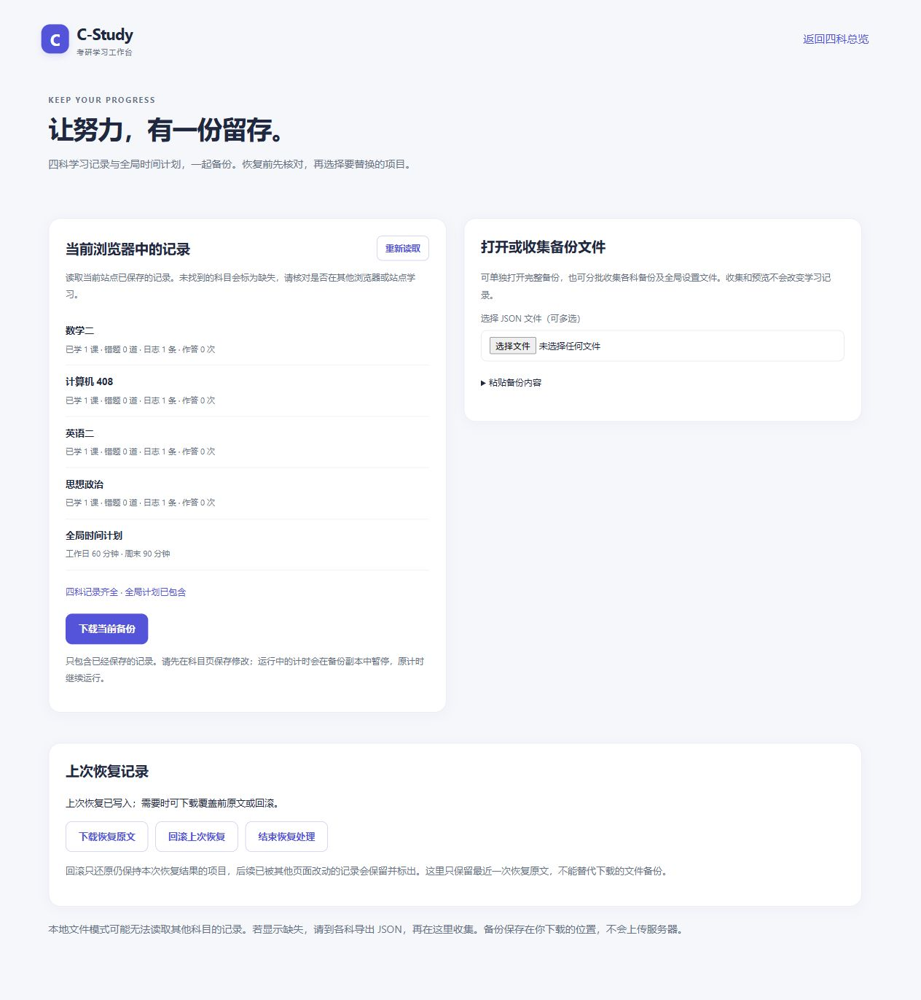

# 四科备份与恢复实施记录（第六批）

日期：2026-10-24。落实 [改进方案的数据保护部分](improvement-plan-2026-10-23.md#32-为备份增加科目和版本信息)，新增 [四科备份与恢复](../backup.html)，保留原有单科导入导出和四科主存储键。

## 使用方法

入口位于四科总览底部、各科「设置与数据 → 数据恢复」和全局计划的备份说明中。

1. 在各科保存修改，再打开备份页。页面列出四科和全局计划的记录状态，未找到记录时显示缺失，无法读取时显示异常。
2. 点击「下载当前备份」，保存一个 JSON；存在缺失或异常时文件名含 `partial`。运行计时只在备份副本中暂停，浏览器中的原计时继续运行。
3. 迁移时打开完整备份，或分批收集各科备份和全局计划设置文件，也可以粘贴 JSON。收集和预览不写入学习记录；重复科目会拒绝，不静默替换已收集的版本。
4. 选择要恢复的项目，预览范围，再点击「确认覆盖选中记录」。恢复替换所选项目的整份记录，不合并新旧进度；缺失、异常和未选择的项目不会被空白默认值覆盖。
5. 完成后重新打开相关科目及计划页。需要撤销时，在「上次恢复记录」预览并确认回滚，检查逐项结果。

「四科记录齐全」表示四科都存在可读取的记录；全局计划是否包含会单独显示。没有启用过全局计划时可备份四科，但不补造一份已保存的全局设置。导出操作不修改各科的 `lastBackup`，因此原有单科备份提醒可能继续显示；下载发起后请自行确认文件已经保存。

## 同源与本地文件模式

统一恢复通过同一浏览器、同一 HTTP 站点下的记录执行。协议、主机或端口变化会进入另一份浏览器存储；例如本地预览不能直接读取线上站点的学习记录，应先在原站点导出再迁移。

本地文件模式的跨文件存储可能隔离，本页无法确认写入后各科是否可见，因此 **file:// 模式只提供收集、下载和拆分，不执行统一恢复或回滚**。可在仓库根目录启动本地预览，例如已安装 Python 时运行：

```powershell
python -m http.server 8080 --bind 127.0.0.1
```

再从 `http://127.0.0.1:8080/backup.html` 统一恢复。继续双击使用时，可在本页的「分别下载，去各科导入」中拆分文件，然后在对应科目「设置与数据」分别导入；全局设置文件在 `plan.html` 导入。

文件模式直接读取出的备份始终标为部分备份。手动收齐四科文件后可明确确认四科齐全，同时保留全局计划的包含状态。缺失不等于从未学习，页面不会据此初始化或覆盖其他科目。

## 文件与兼容范围

完整备份使用 `format: c-study-full-backup`、`schemaVersion: 1`、`exportedAt` 和五项 `entries`。每项 ID 固定为 `math2`、`408`、`en2`、`politics` 或 `planner`，状态为 `included`、`missing` 或 `error`，有效项携带 `data`。状态、科目、版本、内部字段和数值均须通过校验。

| 范围 | 实际行为 |
|---|---|
| 各科学习记录 | 保留设置、掌握状态、课程进度、题目汇总、逐次作答、错题与复习历史、学习日志、套卷成绩、收藏、章节计划和界面记录 |
| 全局计划 | 备份独立的全局预算设置，不写入各科的日目标或章节计划 |
| 单科新备份 | 接受原有 `c-study-backup` 版本 2，拆分后仍使用此格式 |
| 单科旧备份 | 可以依据身份和内容标识确定科目时接受；无法确定的旧文件需先到对应科目确认导入，再重新导出 |
| 旧考点键 | 保留原文数据，进入对应科目后由原有迁移逻辑转换为稳定 ID；不补造历史作答 |
| 计时 | 按已知导出/保存时刻冻结并暂停，备份存放时间不计为学习时间；旧文件没有时刻时不猜测 |
| 异常原文 | 不作为有效学习数据塞入完整备份，可通过「下载该项原文」另行保留 |
| 不包含 | 尚未保存的页面修改、浏览器恢复副本、恢复日志和浏览器偏好；恢复日志另设下载入口 |

全局设置文件兼容现有计划页下载的原始 JSON。一个完整备份请单独打开；单科文件可一次多选或分批收集。每次文件读取最多 5 个、总计 20 MB；任一新文件失败时不保留该批次的部分收集结果，之前已收集的内容继续保留。

`assets/backup.js` 复用 `assets/storage.js` 的单科校验和 `assets/planner.js` 的设置校验；默认配置来自已经生成的 `assets/plan-catalog.js`，不加载四科完整应用或题库，不新增运行依赖。

## 写入失败、中断与冲突

`prepareRestore` 在预览时记录选中主键的原文，`commit` 在写入前及逐项写入时重新核对，检测到其他页面变更就停止。预览只能提交一次，失败或取消后需重新预览。

覆盖主记录之前，先将所有选中项目的原文与拟写入原文保存到 `c-study.full-restore.v1`，已有主记录也另存至原键的 `.recovery`。原主键不存在时明确保存为 `null`，回滚时移除新建主键，恢复原先的缺失状态。

写入失败后尝试按原字节回滚；如果其他页面已经继续改动该项，保留新的记录并标为冲突。空间或读取限制可能阻止回滚，页面会给出未恢复项目，保留原文供下载，不能将部分失败提示为全部成功。最终恢复状态写入失败时也会明确提示核对。

页面中断时，预先保存的恢复记录仍可在下次打开时识别和回滚；不会自动继续覆盖。处于待确认或未完全回滚状态时，新的统一恢复会暂停。核对当前记录后可以「结束恢复处理」，先保留一份恢复原文副本，再移除处理标记，主学习记录保持原样。无法解析的恢复记录也可先下载原文再执行这一流程。

localStorage 的多键写入没有原子事务保证。核对和回滚降低风险，但无法消除极短窗口中的并发写入；恢复过程中应关闭其他编辑页面。恢复原文、拟写入值和 `.recovery` 会占用额外存储空间，空间不足时应先下载文件，再处理记录；浏览器内副本也会随站点数据清理而丢失。这里只保留最近的恢复记录及一份已结束处理的副本，不是长期备份历史。

## 验证

全仓 **28 个测试脚本、69 个 JavaScript 语法检查、86 处本地 HTML 引用通过**，三个生成文件一致性检查通过。新增 `tests/backup.test.js` 已接入 CI：

```powershell
node tests/backup.test.js
```

测试仅使用内存存储，覆盖只读导出、缺失和损坏记录、计时冻结、四科各类学习字段保留、文件收集与旧身份判断、错误批次不污染已收集内容、拆分兼容、选择性恢复、按字节回滚、原键不存在、恢复中断、空间不足、回滚失败、外部更新、恢复日志变更和损坏等场景。页面测试通过异步文件对象验证文件输入处理，并验证 file:// 分支不会执行跨科写入。

本地 HTTP 浏览器使用独立预览站点和合成记录，实际验证了无效 JSON、粘贴读取、范围勾选、预览取消、五项恢复、刷新读回、完整回滚、分批收集和重复拒绝、只恢复英语而保留数学，以及另一页面在预览后更新时停止恢复。恢复后新增数学课程进度，再回滚时保留新进度并显示逐项结果；四科设置页的统一备份入口均可进入。390×844 手机检查无横向溢出，最终页面无控制台错误或警告。

浏览器点按了下载和拆分入口；导出结构与拆分后的单科导入兼容性由自动测试校验。本轮未逐个核对浏览器保存到磁盘的下载文件，也未将粘贴读取的浏览器验证描述为操作系统文件选择器验收。file:// 的写入边界通过页面自动测试验证，本轮未做双击模式的实际浏览器交互。

桌面记录概览：



手机端回滚结果，保留后续已变化的数学记录：


跨设备自动同步、PWA、题型扩充和更多内容关联仍为后续范围；备份文件迁移已经可以独立使用。
