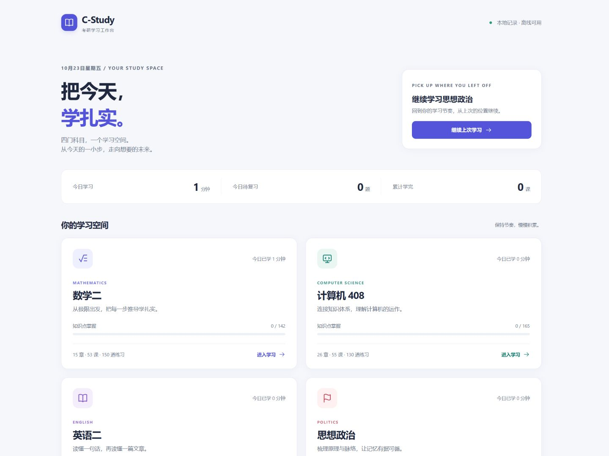
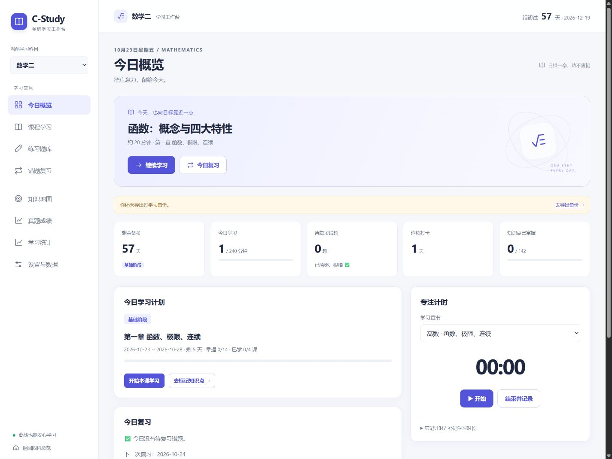

**前端样式与使用体验改版 · 2026-10-23**

四科共用一套界面，保留各科主题色。页面使用本地 CSS、JavaScript 和内联 SVG；无需安装、构建或外部字体。

| 页面 / 流程 | 改版后的行为 |
|---|---|
| 四科总览 | 展示当前浏览器四科的今日学习时长、待复习题数、已学课程；可继续最近打开科目的课程。无法读取记录时显示明确提示，不改写原记录。 |
| 科目首页 | 顶部直接开始或继续未完成课程，旁边进入今日复习；统计摘要与详细计划放在其后。桌面计时独立成栏，补记时长默认收起。 |
| 导航 | 桌面提供侧栏和科目下拉选择；手机提供今日、学习、刷题、错题、更多。更多内包含知识地图、真题成绩、统计、设置及科目总览。页面地址保存当前功能，支持刷新与前进后退。 |
| 课程 | 支持搜索章节、课程名和学习目标。首页继续学习会展开具体课程；今日计划按钮定位计划章节内的未完成课程。做完配套练习可直接返回本课。 |
| 题库 | 增加题目位置进度和重新作答。重新作答隐藏原答案并保留历史记录，再次提交才计入新尝试。非选择题每次作答只接受一次自评。 |
| 筛选练习 | 未做过、做错过、已做对的题集在本轮保持稳定，防止提交后题目突然消失。重新选择筛选条件时，按最新记录重新生成题集。 |
| 错题复习 | 点击开始今日复习，逐题独立回忆、揭示解析、自评，再进入下一题；沿用原有复习间隔算法。 |
| 计时 | 离开首页后，只要计时正在运行或仍有暂停时长，就显示计时条，可暂停、继续及结束记录。课程定位仅在没有进行中的计时时自动选择章节。 |
| 公式 / 速查卡 | 窄屏单列显示；宽公式在卡片内滚动。收藏按钮有明确名称及状态；默写卡支持 Enter / 空格揭示。 |
| 设置 | 备份与清空分区，清空放在默认收起的危险操作中。存储失败时提供持续提示，避免错误显示保存成功；导入旧备份时补齐缺省进度字段。 |
| 对话框 | 支持关闭按钮、Escape、焦点限制与关闭后恢复；打开时背景不可交互。 |

**代码与数据约定**

- `assets/study.css`：总览、四科、桌面和手机的共用样式。
- `assets/common.js`：科目信息、内联图标、文字转义及纯汇总函数；也可由 Node 测试加载。
- `assets/workspace.js`：公共界面，通过各科 `StudyUI.mount(...)` 接口调用引擎；复习算法、课程数据、作答记录仍由各科 `app.js` 管理。
- `assets/portal.js`：读取当前同源下四科记录并呈现总览。考点数与代码一致：数学二 142、408 165、英语二 40、政治 73。
- 各科 localStorage 键保持不变，新加的 `ui` 字段记录最近课程和访问时间，旧记录无需手动迁移。
- 四科目录与 `assets/` 应一起复制。单独复制一个科目目录会缺少共用资源。

**已执行的验证**

- 四科原有 20 个测试脚本，以及所有 JavaScript 的语法检查。
- `node tests/workspace.test.js`：四科真实引擎的重新作答、保留历史、筛选稳定、自评去重、旧记录汇总、存储失败与恢复、总览数量一致性；已接入 CI。
- 内置浏览器通过独立的本地 HTTP 预览地址实际操作：课程定位、练习返回、课程搜索与空状态、答错后重新作答、计时暂停及结束记录、录入到期错题并完成逐题复习、对话框关闭及焦点恢复、八个功能页及浏览器前进后退。
- 检查四科主题；检查 320、360、390 像素手机、768 像素平板与 1440 像素桌面视口。已检查页面横向溢出，公式卡片使用局部滚动。
- 五个 HTML 入口的本地资源与页面链接均存在；公共资源不依赖外网、动态模块导入或 fetch。

浏览器自动安全审核禁止打开 `file://`，因此本次没有完成实际双击 HTML 的浏览器运行验证；此模式仅完成资源与代码检查。不同浏览器可能将各个本地文件的存储分开，总览会显示说明，学习记录以各科页面为准。HTTP / GitHub Pages 同源运行时可以汇总四科记录；线上与本地的记录仍分别保存。

**实际页面截图**

截图来自本地验收页面，包含验收操作产生的少量学习记录。
