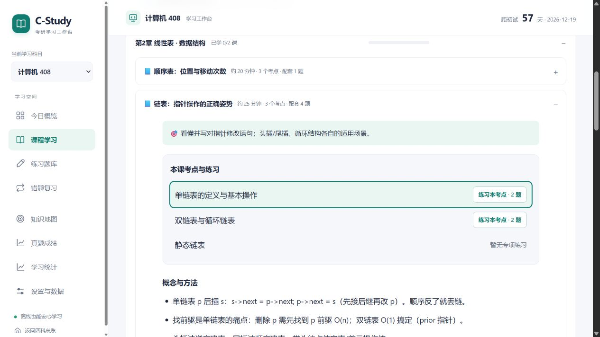

# 首批改进记录

日期：2026-10-23。对应 [改进方案](improvement-plan-2026-10-23.md) 的数据保护、稳定标识和单章学习闭环。保留原生 HTML/CSS/JS、无构建使用方式和四科现有存储键。

## 已实施

| 范围 | 实现 |
|---|---|
| 四科存储 | 共享 `assets/storage.js`；异常 JSON、内部结构损坏、不支持的记录版本和读取失败时停写，保留原文 |
| 备份与恢复 | 新备份带科目与 schemaVersion；旧备份规范化、科目识别或归属确认；导入、清空、快照恢复先保留原文，主记录保存成功后才替换页面状态 |
| 备份计时 | 在导出/保存时刻冻结备份中的运行计时，导入或恢复时暂停；旧备份缺少保存时刻时不猜测经过时长 |
| 失败反馈 | 持续提示和恢复入口；导入或清空失败不再提示成功；计时归档一次保存，失败时保留计时和原日志 |
| 多页冲突 | 监听外部更新并核对原文版本，阻止旧页覆盖新记录，提供导出和重新读取；不承诺原子并发事务 |
| 固定考点 ID | 四科 420 个考点改为 `{id, legacyKey, title}`，156 节课程使用 `pointIds`；按固定映射迁移旧进度，未知键继续保留 |
| 课程覆盖 | 补齐政治「感性认识与理性认识」的课程映射和讲解；校验所有考点均有课程引用 |
| 作答记录 | 四科记录每次提交、对错、首答标记、评分方式和模式，保留旧 `qz` 汇总；旧累计次数不补造历史 |
| 统计刷新 | 新增首答与全部新增尝试两种口径；进入统计、错题等页面时重新渲染最新数据 |
| 408 单章试点 | 线性表 5 道题关联固定考点；从课程进入考点专项练习，解析和复习页回看课程，返回时高亮考点 |
| 深链接 | 支持 `#learn?lesson=Lds02-2&point=408.ds02.singly-linked-list` 和 `#pq?point=408.ds02.singly-linked-list`，刷新及历史导航可恢复目标 |

## 数据兼容与内容维护

- 原有四个 localStorage 主键不变，状态 `v: 1` 继续保留；新备份外层使用 `format: c-study-backup`、`schemaVersion: 2` 和 `subjectId`。
- `.previous` 保存最近有效记录的上一份原文，空间允许时随普通保存更新；`.recovery` 在导入、清空或恢复前保存被覆盖的原文。覆盖操作必须先成功保留原文，才会写主记录。
- 这两份副本也存于当前浏览器，不能替代文件备份；页面明确提供下载入口。
- 考点 `legacyKey` 记录升级前的位置，仅用于旧记录迁移。新内容不要复用旧 ID；重排或改名不修改已有 `id` 和 `legacyKey`。
- 旧课程 `pts` 已转换为 `pointIds`。后续题目可添加 `pointIds`，由共享内容模块推导反向关联。
- 首批题目到考点的关联试点覆盖 408 线性表；第五批扩展到四科共 5 章、28 道题，当前逐章情况见 [内容关联覆盖报告](content-coverage.md)。其他章节的细化关联仍需逐批核对补充。

## 自动验证

在仓库根目录运行：

```powershell
node tests/workspace.test.js
node tests/storage.test.js
node tests/content.test.js
```

再按各科 README 运行原有五个脚本。本轮全部 23 个脚本通过，52 个 JavaScript 文件通过语法检查，52 处本地 HTML 资源引用有效。上述脚本已接入 CI；CI 逐文件检查 JavaScript 语法。

新增验证使用内存中的 localStorage 与真实应用函数，覆盖损坏原文保护、不支持版本、跨科和非法字段、保存失败、导入与清空回滚、有效快照、外部更新冲突、计时归档、固定 ID 重排与迁移幂等、未知旧键保留、内容引用、首次作答与重做区分，以及 408 关联题集。

## 浏览器验证

使用独立的本地 HTTP 预览与合成验收记录，实际检查课程定位与刷新、考点专项练习、答错后回看、重新作答、统计口径、到期错题揭示解析与补课入口、复习评价、恢复入口和两个标签页的冲突提示。文件导入通过页面的文件选择流程执行；损坏 JSON、写满和版本异常由上述自动测试模拟。

实际下载页面导出的备份文件，核对科目为 408、外层版本为 2、包含新增的两次作答记录，且备份中的计时已暂停。

在 390×844 的手机视口检查四科页面，未发现页面横向溢出；固定 ID 改造后，知识点标题和课程正常展示。

没有操作用户线上站点的学习记录。file:// 不依赖动态模块、fetch 或外部资源，但本轮浏览器验收使用 HTTP，不将它视为实际双击模式的运行证据。

课程回看定位与考点专项练习入口：



## 后续批次

第二批已完成 [四科统一搜索与精确定位](search-implementation.md)，第三批已完成 [错题复发、明确归因与复习调度](review-implementation.md)，第四批已完成 [四科全局时间计划](planner-implementation.md)，第五批已完成 [四科内容关联入口与覆盖报告](content-linking-implementation.md)，第六批已完成 [四科备份与选择性恢复](backup-implementation.md)，第七批已完成 [408 页面置换分步演示](replacement-implementation.md)，新增页面置换计算题关联，累计明确关联 6 章、29 题、27 个考点。最新全仓验证为 29 个脚本、72 个 JavaScript 语法检查与 94 处本地 HTML 引用，搜索索引、计划目录与内容覆盖报告均与内容一致。后续按方案推进经过审核的真题题源、题型扩充、更多章节关联和其他按需演示。跨设备自动同步和 PWA 尚未实现。
