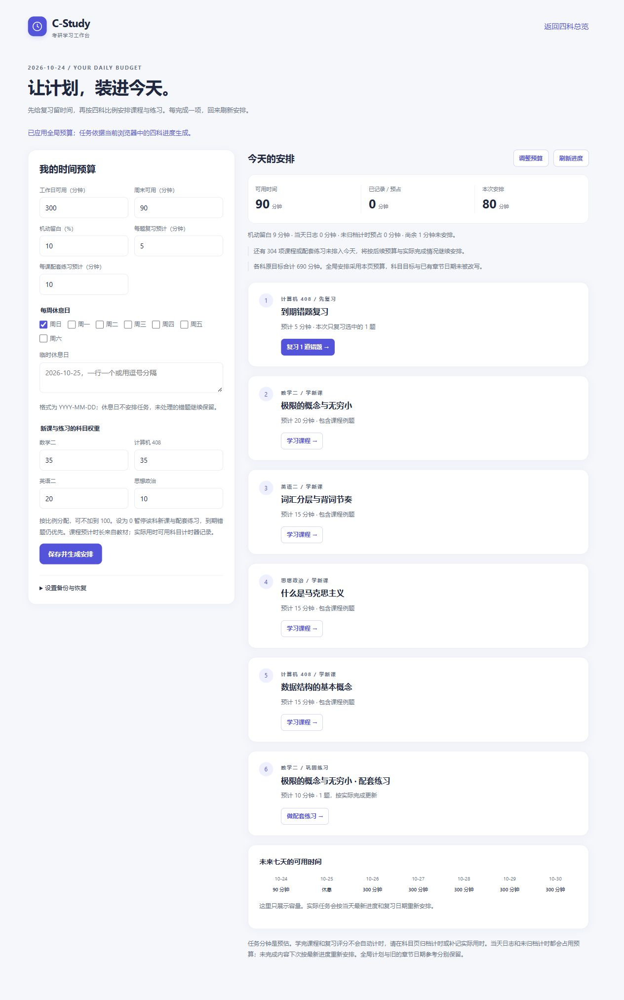

# 第四批改进：四科全局时间计划

日期：2026-10-24。对应 [改进方案第 8 节](improvement-plan-2026-10-23.md#8-p1让四科计划符合实际时间预算)。四科原默认日目标合计 690 分钟，本批增加统一的可用时间约束，让到期复习、课程与配套练习使用同一份预算。

## 使用入口

在 [四科总览](../index.html) 点击「安排今天的学习」，或在任一科的侧栏 / 手机「更多」中点击「四科时间计划」，进入 [计划页](../plan.html)。

1. 设置工作日、周末分钟数、机动留白、每周 / 临时休息日，以及四科权重。
2. 点击「保存并生成安排」。首次打开只预览示例预算，不会自动写入设置。
3. 按任务进入限定错题复习、具体课程或该课配套练习；完成后返回计划页刷新进度。
4. 实际学习时间在科目页归档计时或补记。完成课程和复习评分本身不会自动记录用时。

全局设置有独立的草稿下载、原文下载、覆盖前设置下载、JSON 导入、重新读取和恢复上一份设置入口。四科学习记录仍在各科「设置与数据」分别备份；下载全局设置不会包含课程进度和错题。

跨科读取需要同一浏览器、同一 HTTP 站点下的四科记录。可使用已有在线站点，或在仓库根目录启动本地静态服务，例如已安装 Python 时运行 `python -m http.server 8080 --bind 127.0.0.1`，从 `http://127.0.0.1:8080/` 进入。file:// 的跨文件存储共享由浏览器决定；本次未验收双击文件的跨科交互。

## 排程规则

| 范围 | 实际行为 |
|---|---|
| 预算 | 当天工作日 / 周末额度减去向上取整的机动留白，再减去四科当天日志和未归档计时；剩余不足时不追加任务 |
| 计时预占 | 包含暂停后尚未归档的累计计时；运行中的新增时长与原应用一样最多按 4 小时计入，每科向上取整到分钟 |
| 休息日 | 每周指定日期或临时日期当天不安排任务；已有日志、完成历史和复习日期继续保留 |
| 到期复习 | 先按最早到期日排序，同一天优先有复发记录的卡；一次安排的每科复习批次最多 50 题 |
| 复习积压 | 未排入的卡留在原错题本，下一次生成时继续优先；有到期积压时暂停添加新课和配套练习 |
| 新课与练习 | 从真实的 156 节课程顺序选取；每科按「未学课程 → 尚未完成的本课练习 → 后续课程」形成候选，不为凑分钟跳过前置任务 |
| 科目权重 | 按当天已投入、计时预占和本次已分配分钟相对权重选择下一科；权重为 0 暂停该科新内容，到期错题仍安排 |
| 完成识别 | 已学课程不再添加；该课所有配套题都在学完日期当天或之后有作答记录时，视为完成一轮练习，对错由原题库与错题本继续管理 |
| 未完成任务 | 不创建独立的任务勾选记录；每次从课程、题目与错题的最新状态重算，未完成内容继续成为候选 |
| 考试日期 | 达到某科设置的考试日期后暂停该科新课与练习，到期错题保留；继续备考可修改该科考试日期 |

例如：周末 90 分钟、留白 10%、没有已记录或预占时间，可排额度为 81 分钟；验收样本生成 80 分钟任务，余 1 分钟保持空闲。每项任务的预计分钟合计不会超过生成时的剩余额度。

限定复习通过 `#mistake?review=卡ID,卡ID` 进入，实际只选择这些卡中当前仍到期、未掌握的卡。链接中的卡全部处理完后，不会扩大为全科复习。课程与配套题沿用固定课程 ID 的 `#learn?lesson=...` 和 `#pq?lesson=...`。

## 文件与数据边界

| 文件 | 职责 |
|---|---|
| `plan.html`、`assets/planner-page.js` | 预算表单、保护与恢复入口、今日任务、未来七天可用时间 |
| `assets/planner.js` | 设置校验、受保护的独立存储、只读汇总四科状态、纯函数排程 |
| `assets/plan-catalog.js` | 提交到仓库的公开课程 ID、顺序、时长、配套题引用与科目默认值 |
| `scripts/build-plan-catalog.js` | 从现有大纲、课程和应用默认值生成课程目录；不读取个人浏览器记录 |
| `assets/content.js`、`assets/review.js`、`assets/workspace.js` | 限定复习链接、到期卡选择、科目页入口与现有练习流程复用 |
| `tests/planner.test.js` | 真实内容一致性、预算、积压、进度识别、限定复习和存储边界 |

全局设置使用新的 `c-study.planner.v1` 键。原有四个科目主键、日目标和章节日期计划均不改写；科目首页将原计划标为「章节进度参考」，并提供全局计划入口。

普通保存先保留上一份原文到 `.previous`，导入 / 恢复先保留被覆盖原文到 `.recovery`，保留失败时不覆盖主设置。损坏设置暂停保存与任务生成；保存失败保留表单草稿和当前生效设置。跨页变更通过原文比较和事件检测：有草稿时保护旧页，阻止覆盖；无草稿时重新读取。四科中任何一科记录损坏或不可读时停止跨科排程，原记录不动。

这些浏览器副本不能代替下载备份；冲突检测也不提供原子的跨标签页事务保证。

修改课程顺序、时长、配套题引用或应用默认值后，更新并提交目录：

```powershell
node scripts/build-plan-catalog.js
node scripts/build-plan-catalog.js --check
node tests/planner.test.js
```

涉及教材或题库正文的变更仍需同时更新搜索索引。最终用户无需运行生成器，页面仍使用本地经典脚本，无新增运行依赖。

## 本批交付时的验证记录

全仓 26 个测试脚本通过，64 个 JavaScript 文件语法检查通过，74 处本地 HTML 引用有效，搜索索引与计划目录均与内容一致，`git diff --check` 通过。已将新增测试和目录一致性检查接入 CI。

新增测试包括 200 组预算、留白和任务负荷组合，验证任务分钟守恒、不超剩余额度、不重复安排和积压复习优先；另覆盖休息日与跨日、日志和运行 / 暂停计时、已完成课程和配套题、科目权重、考试日期、50 题分批、过期限定链接、只读四科记录、损坏原文、存储失败、恢复和多页冲突。

浏览器使用独立本地 HTTP 预览和合成的 408 验收错题，实际检查：

1. 12 分钟预算、3 道到期题时只安排 2 题；进入限定复习完成两题后，第三题仍留在队列。
2. 返回计划后重新安排尚未处理的题；将当天设为休息日时归零，不改变错题记录。
3. 90 分钟、10% 留白时安排 80 分钟；直接打开指定课程并标记学完，返回后该课不再作为新课添加。
4. 两个标签页修改预算时，旧页的 100 分钟草稿被保留，新页保存的 120 分钟没有被旧页覆盖。
5. 在 390×844 手机视口操作「调整预算 → 保存并生成安排」，焦点与滚动正确；配套练习进入数学指定课程的唯一一道题，手机「更多」可返回全局计划，页面未见横向溢出。
6. 检查最终预览页，未捕获控制台错误或警告。

重新读取 / 恢复流程未完成端到端浏览器验证；保存、恢复、原文保护和失败边界由自动测试覆盖。浏览器交互验证使用隔离的合成记录，仅涵盖 HTTP；未完成 `file://` 双击模式的跨科交互验证。




## 当前边界

- 排程使用预计时长；未计时、未补记的实际学习时间无法推算，不能据此保证实际用时不超预算。归档计时或补记后刷新，才会减少后续可用额度。
- 配套练习沿用题目级最近作答日期，没有新增每课独立测验历史；同日先做题、后学课的先后顺序无法从旧日期字段精确区分。
- 未来七天仅展示可用时间，不生成七天固定课表，也不承诺完成全部候选内容。任务不会自动改写原来的章节日期参考。
- 全局设置仍可独立备份；第六批已增加 [四科完整备份与选择性恢复](backup-implementation.md)。跨设备自动同步与 PWA 尚未实现。

后续继续推进经过审核的题源与题型、更多章节的考点关联，以及必要的教学演示。
