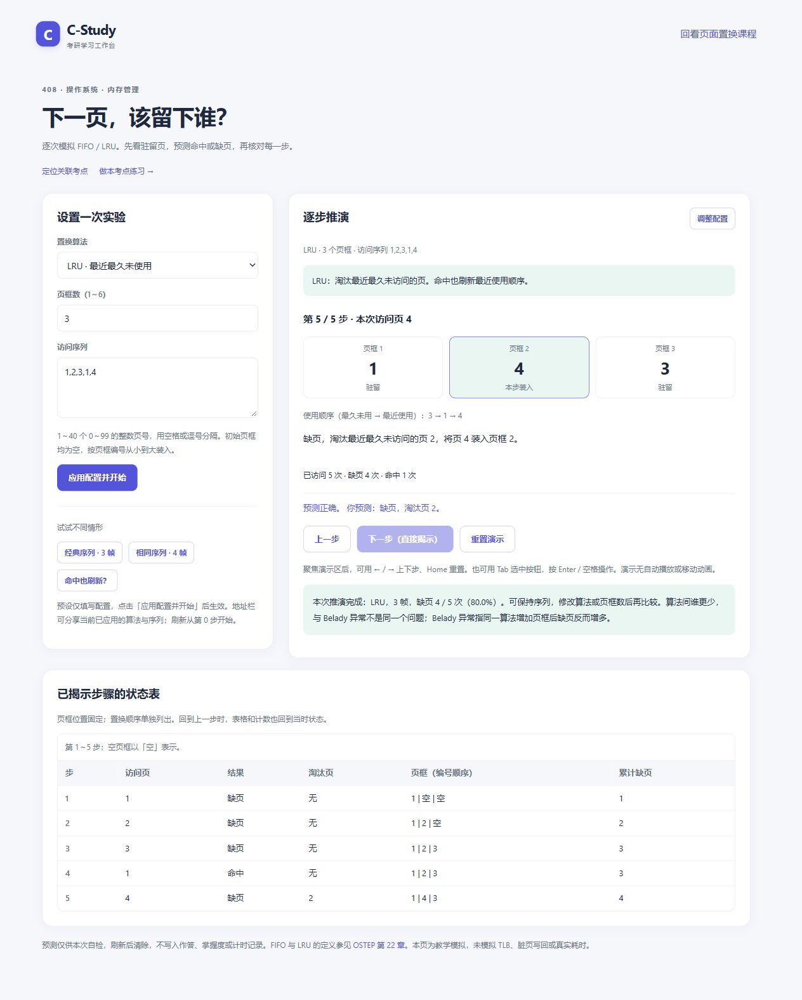

# 第七批：408 页面置换分步演示

日期：2026-10-24。对应 [改进方案](improvement-plan-2026-10-23.md) 9.1 的按需演示。入口为 [页面置换演示](../algorithms.html)，使用原生 HTML、状态表与 JavaScript，无新增依赖。

## 使用流程

1. 选择 FIFO / LRU、1～6 个页框和访问序列，点击「应用配置并开始」。支持 1～40 个 0～99 的页号，用空格、中英文逗号或分号分隔。
2. 初始页框全空。查看当前驻留页，预测下一次访问是命中、装入空闲页框，还是置换；选择置换时还须预测淘汰页。
3. 「确认预测并揭示」核对结果；也可用「下一步（直接揭示）」跳过预测。已揭示过的步骤只能回看，不能把看过答案后的选择记作新预测。
4. 上一步同步回退页框、顺序、累计计数与表格。重置清除本次预测，保留已应用配置。
5. 用预设或自定义序列比较算法、页框数。修改表单只是草稿，明确点击应用后才替换推演；非法输入保留当前有效推演。

地址栏保存已应用配置，复制后可分享，刷新从第 0 步开始。预测不持久化，不纳入作答、掌握度或计时。演示页不读取或写入 localStorage。

## 与已有学习流程连接

- 复用考点 `408.os03.p06`，关联课程 `Los03-2`「虚拟内存与页面置换」。知识地图、该课程和已关联题目的解析都能打开演示。
- 演示可返回具体课程、定位考点或进入考点专项题集；新增题目 `Qos03-3` 到该考点的明确关联。没有新增题目，也不把本章其余题目自动归入本考点。
- 当前全仓明确关联为 **6 章、29 道题、27 个考点**；仍为 368 道题、420 个考点、156 节课。详见 [覆盖报告](content-coverage.md)。
- 总览页提供直接入口；统一搜索可找到原课程、考点与题目，再通过内容入口打开演示。搜索没有新增独立的演示结果类型。

## 算法与内容核对

物理页框位置固定。空闲时按编号从小到大装入；满框缺页时，以独立的顺序队列确定淘汰页。FIFO 命中不改装入顺序；LRU 命中移到最近使用端，不交换物理页框位置。

定义及参考轨迹来自作者公开的 [OSTEP 第 22 章](https://pages.cs.wisc.edu/~remzi/OSTEP/vm-beyondphys-policy.pdf)，特别是 FIFO 图 22.2、LRU 图 22.5，以及 Belady 异常说明。本轮修正原课程把算法间比较与 Belady 异常混用的文案，并收窄「只有 FIFO 会出现」的过度概括。该核对范围不代表整科内容经过独立审校。

经典序列 `1,2,3,4,1,2,5,1,2,3,4,5` 的缺页次数：

| 算法 | 3 个页框 | 4 个页框 |
|---|---:|---:|
| FIFO | 9 | 10 |
| LRU | 10 | 8 |

Belady 异常比较同一算法在增加页框前后的表现。它不能由「固定页框数时 FIFO 比 LRU 缺页少」推出。演示的结尾说明区分这两件事。

当前只实现 FIFO / LRU。没有模拟 OPT、Clock、TLB、脏页写回、I/O 耗时或真实操作系统调度。

## 交互与无障碍

- 每步有文字解释、页框状态、淘汰页与累计命中/缺页计数，不只依赖颜色或动画。
- 所有表单有标签；错误和结果使用提示区；表格有标题及行列标题。
- 原生按钮可用 Tab、Enter、空格；聚焦演示区可用左右方向键与 Home。快捷键只在演示区本身生效，不接管输入框或浏览器组合键。
- 无自动播放或移动动画；沿用共享样式对减少动态效果的支持。
- 手机先展示播放器；「调整配置」定位配置标题，应用后返回播放器。表格在自身区域滚动，不撑宽页面。

## 实现与验证

- [replacement.js](../assets/replacement.js)：输入边界、纯函数轨迹、临时会话、预测及前后步、配置深链接。
- [replacement-page.js](../assets/replacement-page.js)：表单、页框图、状态表和键盘控制；使用文本节点显示自定义输入。
- [content.js](../assets/content.js)：按固定考点加入演示入口，四科仍使用同一套内容关联函数。
- [replacement.test.js](../tests/replacement.test.js)：教材预期轨迹、经典序列、0 页号、1/6 页框、无效输入、1600 组与独立时间戳实现的对照、预测防改写、回退/重置、内容引用、实际页面控制器和禁止读写存储。已接入 CI。

本批交付时全仓执行 **29 个测试脚本、72 个 JavaScript 语法检查、94 处本地 HTML 资源与链接检查**；搜索索引、计划目录、内容覆盖报告均通过一致性校验。测试使用 Node 和模拟 DOM；算法测试与页面控制器测试分别覆盖。

浏览器使用独立同源 HTTP 预览，实际验证正确/错误预测、淘汰页选择、FIFO 3/4 帧、LRU 命中刷新顺序、回退/回看、重置、非法序列保护、配置刷新、方向键/Home、课程/考点/解析往返，以及 390×844 手机布局。页面无横向溢出，状态表可局部滚动，未捕获警告或错误。双击文件模式保持本地脚本加载方式，但本轮未用浏览器实际验收 `file://`。

