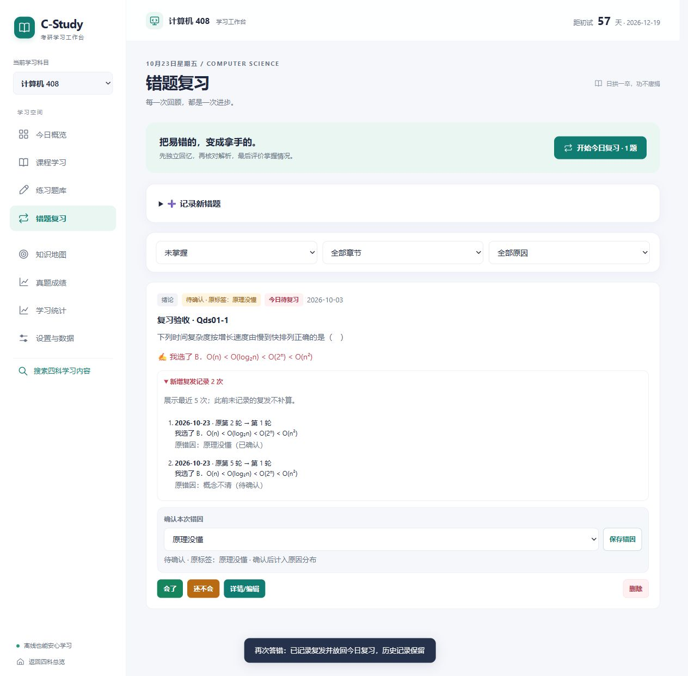
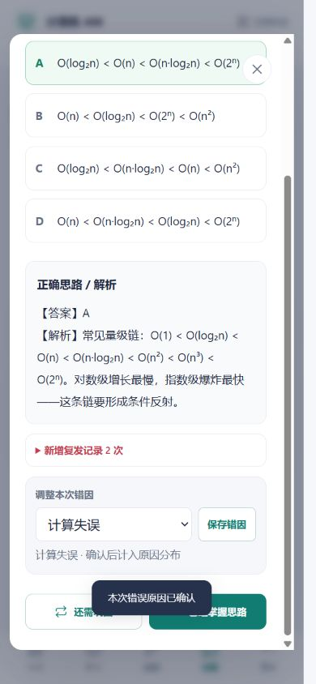

# 第三批：错题复发、明确归因与复习调度

日期：2026-10-23。对应改进方案第 7 节，四科共用规则，继续采用原生静态页面和原有存储键。

## 使用行为

| 场景 | 当前行为 |
|---|---|
| 题库首次答错 | 自动入本，默认「未归因」，次日开始复习 |
| 尚未掌握的题再次答错 | 复用原卡，回到第 1 轮并进入今日队列；已逾期任务保留更早日期 |
| 掌握后再次答错 | 重新激活原卡，回到今日队列；不另建卡，不删除既有复习历史 |
| 同日多次答错 | 每次真实作答分别记录复发；同一道卡只形成一个当前复习任务 |
| 当天复习通过后又答错 | 允许重新进入今日队列，不能因为当天评过一次就忽略新问题 |
| 同日连续点击评分 | 一次成功评分后任务已排到未来，后续点击不能继续提升轮次 |
| 确认错因 | 错题卡和已揭示解析的复习对话框可选原因并保存；详情编辑提供独立确认勾选框 |
| 再次暴露问题 | 保留原错因文字，但撤销本轮确认，旧确认状态进入复发历史 |
| 存储失败 | 复习评分、归因、手工入本、编辑和手工标记掌握均先保存，再替换页面状态；复习对话框不跳下一题，表单不清空 |

间隔仍是原有的 1、2、4、7、15、30 天：初次入本第 1 轮次日复习，通过后进入第 2 轮并间隔 2 天，以此类推；第 6 轮通过后标记掌握。「还需巩固」回到第 1 轮并安排次日。没有引入学习者模型或宣称个性化调度。

手工选择具体错因视为用户明确输入；默认「未归因」不计入某个具体原因。详情中未勾选确认时，即使保留旧原因文字，也不会被统计为已确认。用户仍可主动直接标记掌握，这属于独立的手工操作。

## 代码入口与数据流

| 文件 / 函数 | 责任 |
|---|---|
| `assets/review.js` | `relapse`、`scheduleNext`、`isDue`、`setReason`、`reasonStatus` 和 `reasonSummary`，四科共用 |
| 四科 `app.js` 的 `recordAnswer → addQToMistake` | 关联本次作答 ID，创建待归因错题或记录复发、重排任务 |
| `review`、`confirmMistakeReason`、`commitMistakeChange` | 校验当前任务资格，修改副本，持久化成功后替换内存状态 |
| `renderMistakeList`、`renderStats` | 复发筛选、到期评分按钮、确认状态与原因统计；具体原因只统计明确确认的当前标签 |
| `assets/workspace.js` | 卡片及复习中的原因选择、最近复发记录、评分失败时保留当前题 |
| `assets/storage.js` | 新字段、复发事件结构、日期、ID、重复作答关联及非法数据校验 |
| `tests/review.test.js` | 共享规则、四科真实应用动作、失败回滚及备份兼容回归；已接入 CI |

新增字段：

```js
{
  reason: '未归因',
  reasonConfirmed: false,
  reasonConfirmedAt: null,
  lastWrongAt: '2026-10-23T02:00:00.000Z',
  recurrences: [{
    id: 'recurrence-id', date: '2026-10-23', at: '2026-10-23T02:00:00.000Z',
    attemptId: 'attempt-id', fromStage: 4, fromNextReview: '2026-11-07',
    wasMastered: false, previousWrong: '此前错解', previousReason: '概念不清',
    previousReasonConfirmed: true, wrong: '本次错解', wrongIdx: 1
  }]
}
```

`stage` 仍以 0 为起点；页面轮次加 1。`history` 保留复习评价，`recurrences` 单独保留复发证据。相同 `attemptId` 不重复登记复发；同日不同作答 ID 保留为不同事件。页面仅展示最近 5 次复发，完整事件仍在状态和备份中。

## 旧数据与统计口径

- 继续使用状态 `v: 1` 和备份外层 `schemaVersion: 2`，新字段为增量字段，原有四个主键不变。
- 旧卡缺少确认字段时，原文字显示为「待确认 · 原标签：…」，归入「未归因」；不把此前自动标签当作本人确认。
- 旧卡的自定义原因可在详情和快捷选择中保留，确认后可进入统计。仅保存其他字段不会默认为它确认。
- 不重建缺失的旧复发历史；已有旧重复卡不批量合并。新复发优先复用现有未掌握卡，没有时重新激活已有掌握卡。
- 原因分布按错题卡当前确认状态计数，不是每次作答或每次复发的原因分布；已掌握卡也包含在错题总数中。
- 新字段结构损坏时沿用原文保护和停写机制；浏览器副本仍不能替代文件备份。

## 本批交付时的验证记录

仓库根目录运行：

```powershell
node tests/review.test.js
```

全仓 25 个测试脚本通过，59 个 JavaScript 文件逐文件语法检查通过，64 处本地 HTML 引用有效，搜索索引仍与内容一致，`git diff --check` 通过。

新增测试通过真实四科应用函数验证：高阶段复发、逾期日期不后移、掌握后重开原卡、同日多次真实作答、同日防连评、复习后再错、旧标签与自定义原因、手工入本、编辑、写入失败回滚、备份往返和非法新增字段保护。纯函数另外覆盖跨年、闰年和夏令时附近的日历计算。

浏览器使用独立本地 HTTP 预览和合成样本，实际完成：

1. 导入一张第 5 轮、两周后到期的 408 旧卡，确认旧标签待确认且未来任务没有即时评分按钮。
2. 题库答错后回到今日队列，保留原卡与复习历史，展开查看复发前阶段。
3. 先回忆再揭示解析，在对话框中确认原因并评分；统计更新，刷新后保留记录。
4. 当日再次重做答错，原确认状态保留在历史里，当前卡重新待确认并回到今日队列。
5. 390×844 手机视口完成错因保存和「还需巩固」，页面和对话框未见横向溢出。
6. 数学、英语、政治页面实际答错入本并保存原因，政治另经详情勾选确认再保存；查看的浏览器错误与警告记录为空。

损坏字段、写入失败和重复提交的边界由隔离测试覆盖，浏览器未逐项模拟这些异常。浏览器交互验证使用 HTTP 与合成记录，未完成 `file://` 双击模式的交互验证。





后续已交付 [四科全局时间预算与限定复习安排](planner-implementation.md)、[四科内容关联](content-linking-implementation.md) 和 [四科完整备份与选择性恢复](backup-implementation.md)。更多经过审核的题源与章节关联、跨设备自动同步和 PWA 仍待推进。
